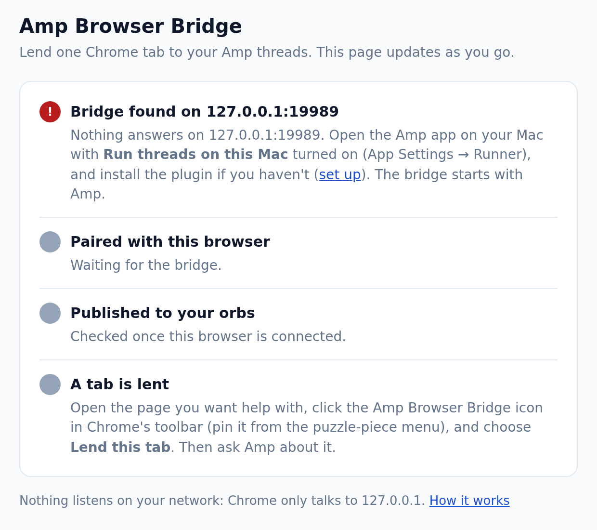
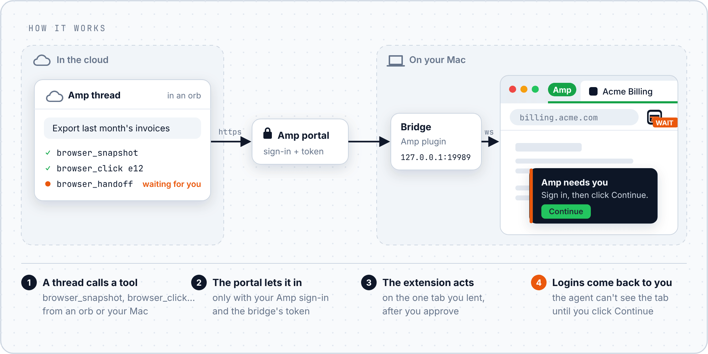

<p>
  <picture>
    <source media="(prefers-color-scheme: dark)" srcset="docs/banner-dark.png">
    
  </picture>
</p>

<br>

Your [Amp](https://ampcode.com) threads, even ones running in an orb in the cloud, can read a Chrome
tab you lend them, logins included, and ask before they click or type. When a step needs a person,
like a login, a 2FA code or a payment, the agent hands the tab back to you and waits.

Ask things like:

- *"Read my lent tab and summarise the open issues."*
- *"Fill in this form from the spec in the repo, but let me check it before submitting."*
- *"Reproduce the bug on this page and take a screenshot of the error."*

## Why it's safe

- **You choose the tabs.** The agent works only on the tab you lent and, if you turn them on, tabs
  it opened itself. It has no tool for your other tabs, your cookies or your history.
- **The lent tab is read-only and stays on its site** until you tick boxes in the popup that allow
  clicks, typing and navigation, and other sites.
- **Amp asks before each action** that changes a page, or once per site per thread if you say so.
- **You take over for secrets.** During a handoff the agent can't read or act on that tab. Your
  click on **Continue** gives it back.
- **Nothing is open to your network.** The bridge listens on `127.0.0.1` only. Orbs reach it through
  an Amp portal that needs your Amp sign-in, and every request is signed with the bridge's token,
  which is never sent. The extension and the bridge prove to each other that they share a key before
  the extension does anything.
- **Stop anytime.** Click **Stop lending**, close the tab, or click Cancel on Chrome's "started
  debugging" bar.

The approval prompts are a convenience, not a hard limit: code running in your orb can skip them.
[Security](#security) has that and the rest of what this does not protect against.

## Set up

You need the [Amp app for macOS](https://ampcode.com/docs/apps/mac) with **Run threads on this Mac**
and **Allow Portals** turned on (App Settings → Runner), and Chrome 116 or newer.

1. **Install the plugin.** In any Amp thread, ask:

   ```prompt
   Install the plugin/ directory from https://github.com/lox/amp-browser-bridge into my personal plugins as browser-bridge, then push it.
   ```

   It lands in your Personal Plugins repository, so new threads on your Mac and in your orbs get it.

2. **Load the extension.** It's submitted to the Chrome Web Store but not published yet, so for now
   you load it unpacked. Download
   [`amp-browser-bridge-0.2.0.zip`](https://github.com/lox/amp-browser-bridge/releases/download/v0.2.0/amp-browser-bridge-0.2.0.zip)
   from the [v0.2.0 release](https://github.com/lox/amp-browser-bridge/releases/tag/v0.2.0)
   (sha256 `64bcdcb5e14925b9e15aaace5180ff4ca3896e11baa221a34d278256a6c32880`) and unzip it.
   Open `chrome://extensions`, turn on **Developer mode**, click **Load unpacked**, and pick the
   unzipped folder. Pin the extension from Chrome's puzzle-piece menu. Its ID is always
   `goknnphohomgekkahpdiphdfladfnmoc`.

   Chrome opens the extension's setup page, which follows the remaining steps live and says how to
   fix any that fail. Reopen it from the popup's **Setup and status** link.

3. **Pair it.** In an Amp thread on your Mac, ask *"pair the browser extension"*. Amp opens the setup
   page with a one-time code, and the extension pairs by itself.

4. **Publish it to your orbs.** In an Amp thread on your Mac, ask *"publish the browser bridge"* and
   confirm. The portal belongs to that thread, so keep it unarchived. Skip this step if you only use
   threads on your Mac.

The setup page then looks like this. Its last step turns green once you lend a tab:

<p align="center"></p>

## Use it

Open the page you want help with, click the extension, and choose **Lend this tab**. Then ask Amp
about it. The tab is lent read-only and limited to its current site.

- **Allow clicks, typing and navigation** lets the agent act on the page. Amp asks before each
  action; **Allow on *site* in the lent tab for this thread** stops the questions for that thread on
  that site.
- **Allow other sites** lets the agent navigate away from the site you lent the tab on. If you
  browse away yourself, the agent's commands are refused until you come back.
- **Continue** ends a handoff, on the card the agent shows on the page or in the popup.
- **Release to other threads** frees the tab from the thread holding it, so the next thread to ask
  gets it. One thread holds the tab at a time, until it has been idle for 10 minutes. Release
  doesn't end the lend: the tab stays lent and in the Amp group. **Stop lending** ends it.
- The lent tab moves into a green **Amp** tab group, and goes back to its earlier group when you
  stop lending. On that tab the toolbar badge shows `ON`, `RUN` while a command runs, and `WAIT`
  when Amp needs you.

If a dialog, banner or overlay covers the element the agent wants to click, type into, select in or
press a key on, the action is refused rather than landing on whatever is on top.

### Amp's own tabs

**Let Amp open its own tabs** in the popup is off by default. With it on, a thread can open pages
without you lending one: Amp asks before it opens a site, then the tab opens in the background of
the window you last used, in a collapsed green **Amp** tab group. The collapsed group is easy to
miss; the popup lists Amp's tabs with **Show** and **Close**.

- Only the thread that opened a tab can use it. A thread can have several, while another thread
  holds the lent tab.
- Clicks, typing and navigation in them need no checkbox and may go to any site. Amp still asks
  before each action, or once per site per thread.
- They close after 10 minutes without a command, never while one runs or while Amp waits for you.
  Turning the setting off closes them all.
- A handoff in one of them expands its group, shows `WAIT` on every tab's toolbar button, and the
  popup says which tab needs you.
- A tab stops being Amp's when you lend it, drag it out of the group, rename or recolour the group,
  or click Cancel on Chrome's "started debugging" bar. It stays open, as yours.

**Known bug:** in one of Amp's tabs that has never been shown, clicks, and the Enter that
`browser_type` or `browser_fill` send with `submit`, are silently dropped, though the tool reports
success. It happens on macOS and Linux. Show the tab once first (click it, or **Show** in the popup).

### Bot checks

After `browser_navigate` and `browser_open_tab`, and with every snapshot, the extension checks
whether the page is a bot check (Cloudflare's "Just a moment...", a captcha, PerimeterX "Press &
Hold", DataDome) or a block page ("Sorry, you have been blocked", "Access Denied"). After a
navigation it waits up to 12 seconds for a check that clears by itself. If one is still there, the
result tells the agent to hand the tab to you with `browser_handoff`; on a block page, to stop. It
never tries to solve one. Detection is adapted from
[OpenCode Browse](https://github.com/anomalyco/browse) and reads only the page's title, the start of
its text, its frame and script addresses and a few vendor elements.

## Troubleshooting

The setup page is the first place to look; each red step says how to fix it:

<p align="center"></p>

- **"Nothing answers on 127.0.0.1:19989".** Open the Amp app with **Run threads on this Mac**
  turned on, and check the plugin is installed. The bridge starts with Amp.
- **"Something other than the bridge answers on port 19989".** Quit the program holding the port,
  then restart the Amp app.
- **Pairing didn't happen.** If Chrome shows the setup page as blocked, reload it. If it's still
  blocked, open **Setup and status** from the popup once, so the bridge learns this build's ID, then
  ask Amp to pair again. Or enter the code from `~/.amp-browser-bridge/pairing-code` on the setup
  page. Codes last 10 minutes.
- **"The extension was updated and now pairs in a safer way".** Browsers paired with a version
  before 0.2.0 pair once more. Update the plugin on your Mac too, then ask Amp to *"pair the browser
  extension"*.
- **"The bridge no longer knows this browser".** The bridge has no key for it, for example after
  `~/.amp-browser-bridge` was removed. Ask Amp to *"pair the browser extension"*.
- **"Something on 127.0.0.1:19989 could not prove it is your bridge".** Either another program
  holds the bridge's port (quit it, then restart the Amp app), or another browser or Chrome profile
  has paired with the bridge since; the bridge keeps one key, so ask Amp to pair this one again.
- **Orbs can't reach the tab.** Check the setup page's **Published to your orbs** step. If it's red,
  or the thread that owns the portal was archived, ask *"publish the browser bridge"* again from a
  thread on your Mac. Orbs that were already running need `amp orb restart-processes` to pick up
  the new secrets.

## Tools

| Tool | What it does |
| --- | --- |
| `browser_status` | Connection, lent tab, which thread holds it, this thread's own tabs, how its last handoff stands, and what to do next |
| `browser_open_tab`, `browser_close_tab` | Open a background tab of the thread's own, after your approval, and close it. If the new tab can't be used, it is closed again |
| `browser_snapshot` | Accessibility outline with refs (`e12`) for the action tools; flags a bot check or block page |
| `browser_screenshot` | JPEG of the viewport |
| `browser_wait_for` | Wait (up to 20 seconds) for text, a URL or an element by role and name to appear |
| `browser_scroll` | Scroll by a number of pixels |
| `browser_click`, `browser_type`, `browser_navigate` | Act on the page, after your approval. `browser_navigate` waits for the page, reports a bot check or block page, and reports a URL that starts a download as `download` rather than an error |
| `browser_fill` | Like `browser_type`, but hides the value of password and one-time-code fields in the approval prompt and the result |
| `browser_press` | Press a key such as Enter, Escape or Tab, on a ref or on whatever has focus, after your approval |
| `browser_select` | Choose an option of a `<select>` by value or label, after your approval |
| `browser_handoff` | Hand the tab to you and wait for **Continue** (up to 30 minutes). If a call is lost while the card is up, calling it again waits for the same card |
| `browser_bridge_pair` | On the Mac only: open the setup page with a new one-time pairing code |
| `browser_bridge_publish` | On the Mac only: expose the bridge to your orbs; it republishes itself on every start |

Page tools take an optional `tab` (from `browser_open_tab`); without it they use the lent tab.

Chrome never lets extensions control Chrome Web Store pages, so the tools refuse them, and a lent
tab you take there stops being lent. Do those steps by hand.

The download and Web Store handling, and closing a tab `browser_open_tab` can't use, are on `main`
and not yet in the v0.2.0 extension.

## Security

The agent works in a browser you are signed in to, so treat what it reads as untrusted: a page or
an email can try to steer it.

- **Who can drive the tab.** Requests to the bridge are signed with `BROWSER_BRIDGE_TOKEN` (in
  `~/.amp-browser-bridge/token`, mode 600): an HMAC of the method, path, thread and body, a time
  within five minutes of the bridge's clock, and a nonce the bridge accepts once. The bridge signs
  its answers the same way, and the plugin rejects answers it didn't sign. The token itself is never
  sent to the bridge. Through the portal, Amp also requires your sign-in.
- **Pairing.** A pairing code works once, within 10 minutes, and five wrong codes void it. The
  browser exchanges it for a random key of its own over a fresh ECDH key agreement, with the code
  stretched by PBKDF2, so neither the code nor the key crosses the connection in the clear. On every
  connection both sides prove they hold the key with an HMAC over fresh nonces, the bridge first;
  the extension sends nothing about your tabs and obeys nothing until then. The extension link
  accepts only this extension's two IDs (unpacked and Web Store), dialled as `127.0.0.1` or
  `localhost`, which turns away web pages, other extensions and DNS rebinding. The HTTP API refuses
  cross-site browser requests.
- **What that does not cover.** Programs running as you can read `~/.amp-browser-bridge` and
  Chrome's storage, so they can do anything you can. A program that holds port 19989 while the
  bridge is down sees what threads send (tool names and arguments, such as text to type). It can't
  make new requests or answer as the bridge, but it could replay one it saw to the real bridge
  within five minutes. It can also make the extension drop its key by refusing it, so you pair
  again.
- **What enforces what.** The extension enforces the hard limits: only the lent tab and, if you
  allowed them, tabs Amp opened; the lent tab read-only and on its own site until you allow more;
  nothing on a tab during its handoff. The approval prompts guard the agent's tools, but code
  running in your orb can read `BROWSER_BRIDGE_TOKEN` and call the bridge directly, so keep the lent
  tab read-only unless you are watching. The one-thread lease and each tab belonging to the thread
  that opened it keep threads from interleaving; they are not security boundaries.
- **Amp's own tabs are wider.** With **Let Amp open its own tabs** on, anyone with the token can
  open any site in your signed-in browser and click and type there, without the lent tab's
  read-only and one-site limits. Only the approval prompts stand in the way, and code in an orb can
  skip those. Keep it off unless you want that.
- **Refs.** They expire when the page navigates, and an element is checked against the snapshot's
  role and name before each action. If the page moves focus while text is typed, the result is
  reported as unknown.
- **What it sees.** Snapshots and `browser_wait_for` leave out what's typed in fields. Screenshots
  show the page as it is. `browser_fill` hides what goes into password and one-time-code fields from
  the approval prompt and its result, but the agent chose the value, so it still knows it.
- **The card.** A page can't press **Continue** for you, but it can hide the card; use the popup's
  **Continue** then.
- **Limits.** The site limit covers navigation, not requests the page makes itself. If an answer is
  lost in the middle of an action (the extension disconnects, or the portal times out), the result
  is reported as unknown and never retried, so check the page.

## How it works

<picture>
  <source media="(prefers-color-scheme: dark)" srcset="docs/how-dark.png">
  
</picture>

`plugin/index.ts` decides its role by platform: on macOS it runs the bridge (`plugin/host.ts`);
elsewhere it reads `BROWSER_BRIDGE_URL` and `BROWSER_BRIDGE_TOKEN`, signs in to the portal with
`amp portal login-url`, and forwards each tool call. Every Amp process on the Mac loads the plugin;
the first one to bind port 19989 runs the bridge and the others take over if it exits. Set
`AMP_BROWSER_BRIDGE_ROLE` to `host`, `client` or `off` to override, and `BROWSER_BRIDGE_PORT` to
change the port (the extension expects 19989). You can also run the bridge without Amp:
`bun plugin/host.ts`.

Publishing serves the bridge through a [runner portal](https://ampcode.com/docs/cli/runners) owned
by the thread you asked in, and stores `BROWSER_BRIDGE_TOKEN` as a personal Amp secret and
`BROWSER_BRIDGE_URL` as a personal environment variable, which new orbs receive. The bridge
republishes itself through the same thread every time it starts. The portal's address depends on
the directory the `amp` CLI runs in, so the plugin always runs it from `~/.amp-browser-bridge`, and
the address stays the same across restarts and plugin updates. If republishing fails, the setup
page shows the bridge as not published.

The extension (`extension/`) attaches Chrome's debugger only to the lent tab and Amp's own tabs. Its
half of the pairing handshake is `extension/pairing.js`; the bridge's half is in `plugin/host.ts`,
and the tests run the two against each other. The lend, snapshot refs and a waiting handoff live in
session storage, so they survive a service worker restart; the key and the list of Amp's own tabs
live in local storage.

The setup page (`extension/setup.html`) finds the bridge by its `401` answer on
`http://127.0.0.1:19989/status`, sending the extension's ID in `x-extension-id`. The bridge records
the last known ID it saw in `~/.amp-browser-bridge/extension-id`, and pairing opens
`setup.html#code=<code>` under that ID, so it reaches the build you installed. With no ID recorded
it picks the Web Store build. The bridge also tells the extension where it is published (portal URL,
owning thread and time, never the token), so the setup page can show it.

## Develop

```sh
bun install
bun run check   # type check, syntax check the extension, run the tests
CHROME_BIN=/path/to/chromium bun run e2e   # the real extension in headless Chrome against a real bridge
```

`test/fixtures/challenges/` holds what the challenge probe read from real challenge, block and
ordinary pages, with IP addresses and query values scrubbed; `test/challenge.test.ts` checks how
each is classified. Add a page there when detection misses one or flags one wrongly.

`bun run e2e` runs each `test/e2e/*.e2e.ts` on a fresh bridge home and Chrome profile, using ports
8765, 9333 and 19989, so quit a running bridge first. `CHROME_BIN` must be Chromium or Chrome for
Testing; branded Chrome ignores `--load-extension`. Pass a name to run one script, such as
`bun run e2e lend`. CI runs both on Buildkite with
[`.buildkite/pipeline.yml`](.buildkite/pipeline.yml).

After changing `extension/`, click **Reload** on its card in `chrome://extensions`.

The README images and `docs/tweet-card.png` are drawn by `docs/art/art.ts`; its header says how to
render them.

## Release

```sh
bun run release            # dist/amp-browser-bridge-<version>.zip, keeps the fixed ID
bun run release --no-key   # without the manifest key, for Chrome Web Store uploads
```

The version comes from `extension/manifest.json`; bump it before each release. The zip is the
`extension/` folder as is, and the same sources always give the same bytes. Unzip it and use
**Load unpacked** to try it.

The unpacked build's fixed ID comes from the `key` in `extension/manifest.json` and is exported as
`UNPACKED_ID` from `plugin/extension-id.ts`; a test fails if they disagree. The Chrome Web Store
item has its own ID, `STORE_ID` in the same file, because the store keeps its own key; store
uploads always use `--no-key`. The plugin works with both.

The extension is submitted to the Chrome Web Store as Unlisted and is waiting for review.
[`docs/chrome-web-store.md`](docs/chrome-web-store.md) has the upload checklist, listing text,
permission justifications and the plan for moving to the store's ID;
[`docs/privacy.md`](docs/privacy.md) is the privacy policy. `CHROME=<Chromium binary> bun
scripts/store-images.ts` renders the store screenshots and promo tile into `docs/store/`.

## License

[MIT](LICENSE)
