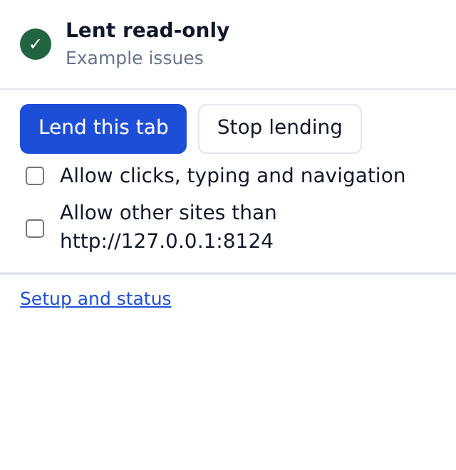

# Amp Browser Bridge

**Lend one Chrome tab to your [Amp](https://ampcode.com) threads, even ones running in an orb in the
cloud.** The agent sees the page as you do, logins included, and asks before it clicks or types.
When a step needs a person, like a login, a 2FA code or a payment, it hands the tab back to you
and waits.

<p align="center">
  
  &nbsp;
  
</p>

Ask things like:

- *"Read my lent tab and summarise the open issues."*
- *"Fill in this form from the spec in the repo, but let me check it before submitting."*
- *"Reproduce the bug on this page and take a screenshot of the error."*

## Why it's safe

- **You choose the tab.** The agent works on the one tab you lent, through a fixed set of page
  actions. It can't open your other tabs or read your cookies or history.
- **Read-only until you say otherwise.** Clicking, typing and navigation stay off until you tick a
  box in the popup. Even then, Amp asks you before each action, or once per site if you say so.
- **It stays on one site.** The tab can't wander off the site you lent it on unless you allow it.
- **You take over for secrets.** During a handoff the agent can't see or touch the tab, so it never
  sees what you type. Only your real click on **Continue** gives it back.
- **Nothing is open to your network.** The bridge listens on `127.0.0.1` only. Orbs reach it
  through an Amp portal that needs your Amp sign-in and a secret token.
- **Stop anytime.** Click **Stop lending**, close the tab, or cancel Chrome's "started debugging"
  bar.

The details, including what this does *not* protect against, are under [Security](#security).

## Set up

You need the [Amp app for macOS](https://ampcode.com/docs/apps/mac) with **Run threads on this Mac**
and **Allow Portals** turned on (App Settings → Runner), and Chrome 116 or newer. Setup takes a few
minutes and no terminal.

1. **Install the plugin.** In any Amp thread, ask:

   ```prompt
   Install the plugin/ directory from https://github.com/lox/amp-browser-bridge into my personal plugins as browser-bridge, then push it.
   ```

   It lands in your User Plugins repository, so new threads on your Mac and in your orbs get it.

2. **Load the extension.** [Download this repository](https://github.com/lox/amp-browser-bridge/archive/refs/heads/main.zip)
   and unzip it. Open `chrome://extensions`, turn on **Developer mode**, click **Load unpacked**,
   and pick the `extension` folder. Pin the extension from Chrome's puzzle-piece menu. It always
   gets the ID `goknnphohomgekkahpdiphdfladfnmoc`, which is how Amp finds its setup page.

   Chrome opens a setup page that follows the remaining steps live and says what to do at any
   step that fails. Reopen it any time from the popup's **Setup and status** link.

3. **Pair it.** In an Amp thread on your Mac, ask *"pair the browser extension"*. Amp opens the
   setup page with a one-time code and the extension pairs by itself.

4. **Publish it to your orbs.** In an Amp thread on your Mac, ask *"publish the browser bridge"*
   and confirm. Keep that thread unarchived: the portal belongs to it. Skip this step if you only
   use threads on your Mac.

When all four steps are green, you're done:

<p align="center"></p>

## Use it

Open the page you want help with, click the extension, and choose **Lend this tab**. Then ask Amp
about it.

- **Allow clicks, typing and navigation** lets the agent act on the page. Amp asks before each
  action; **Allow on *site* for this thread** stops the questions for that thread on that site.
- **Allow other sites** lets the agent navigate away from the site you lent the tab on. If you
  browse away yourself, the agent waits until you come back.
- **Continue** ends a handoff, on the card the agent shows on the page or in the popup.
- **Release to other threads** frees the tab. One thread holds it at a time, until it has been idle
  for 10 minutes.
- The toolbar badge shows `ON` while a tab is lent, `RUN` while a command runs, and `WAIT` when Amp
  needs you.

If a dialog, banner or overlay covers what the agent wants to click, the click is refused rather
than hitting whatever is on top.

## Troubleshooting

The setup page is the first place to look; each red step says how to fix it:

<p align="center"></p>

The common cases:

- **"Nothing answers on 127.0.0.1:19989".** Open the Amp app with **Run threads on this Mac**
  turned on, and check the plugin is installed. The bridge starts with Amp.
- **"Something other than the bridge answers on port 19989".** Quit the program holding the port,
  then restart the Amp app.
- **Pairing didn't happen.** If Chrome wasn't running, the setup page may say it was blocked;
  reload it. Or copy the code from `~/.amp-browser-bridge/pairing-code` into the setup page. Codes
  last 10 minutes.
- **Orbs can't reach the tab.** Ask *"publish the browser bridge"* again from a thread on your Mac.
  Orbs that were already running need `amp orb restart-processes` to pick up a new address.

## Tools

| Tool | What it does |
| --- | --- |
| `browser_status` | Connection, lent tab, who holds it, and what to do next |
| `browser_snapshot` | Accessibility outline with refs (`e12`) for click and type |
| `browser_screenshot` | JPEG of the viewport |
| `browser_scroll` | Scroll by a number of pixels |
| `browser_click`, `browser_type`, `browser_navigate` | Act on the page, after your approval |
| `browser_handoff` | Hand the tab to you and wait for **Continue** (up to 30 minutes) |
| `browser_bridge_pair` | On the Mac only: open the setup page with a new one-time pairing code |
| `browser_bridge_publish` | On the Mac only: expose the bridge to your orbs; it republishes itself on every start |

## Security

The agent works in a browser you are signed in to, so treat what it reads as untrusted: a page or
an email can try to steer it.

- **Who can drive the tab.** HTTP calls need `BROWSER_BRIDGE_TOKEN` (stored in
  `~/.amp-browser-bridge/token`, mode 600). The extension proves itself with a key it received for a
  one-time pairing code; five wrong codes void the code, and the code never leaves your Mac.
  Through the portal, Amp also requires your sign-in.
- **What enforces what.** The extension enforces the hard limits: only the tab you lent, read-only
  until you allow actions, on its own site until you allow others, nothing during a handoff. The
  approval prompts in Amp are a convenience on top: they guard the agent's tools, but code running
  in your orb can read `BROWSER_BRIDGE_TOKEN` and call the bridge directly. So keep tabs read-only
  unless you are watching. Likewise, the one-thread lease keeps threads from interleaving; it is
  not a security boundary.
- **Refs.** They expire when the page changes, and an element is checked against the snapshot's
  role and name before each action. If the page moves focus while text is typed, the result is
  reported as unknown.
- **What it sees.** Snapshots leave out what's typed in fields. Screenshots show the page as it is.
- **The card.** A page can't press **Continue** for you, but it can hide the card; use the popup's
  **Continue** button then.
- **Limits.** The site limit covers navigation, not requests the page makes itself. If an answer
  is lost in the middle of an action (the extension disconnects, or the portal times out), the
  result is reported as unknown and never retried, so check the page.

## How it works

```text
orb thread ── browser_* tools ──https──▶ Amp portal ──▶ Amp plugin on your Mac
                                                          │ bridge on 127.0.0.1:19989
                                       Chrome extension ◀─┘ (loopback WebSocket)
```

`plugin/index.ts` decides its role by platform: on macOS it runs the bridge (`plugin/host.ts`);
elsewhere it reads `BROWSER_BRIDGE_URL` and `BROWSER_BRIDGE_TOKEN`, signs in to the portal with
`amp portal login-url`, and forwards each tool call. Every Amp process on the Mac loads the plugin;
the first one to bind port 19989 runs the bridge and the others take over if it exits. Set
`AMP_BROWSER_BRIDGE_ROLE` to `host`, `client` or `off` to override, and `BROWSER_BRIDGE_PORT` to
change the port (the extension expects 19989).

Publishing serves the bridge through a [runner portal](https://ampcode.com/docs/cli/runners) owned
by the thread you asked in, and stores `BROWSER_BRIDGE_URL` and `BROWSER_BRIDGE_TOKEN` as personal
Amp secrets, which every new orb receives. After that, the bridge republishes itself every time it
starts, re-registering the portal through the same thread and updating `BROWSER_BRIDGE_URL` if the
address changed.

The extension (`extension/`) attaches Chrome's debugger to the lent tab only. Its state lives in
session storage, so a service worker restart keeps the lend, the snapshot refs and a waiting
handoff. The bridge tells the extension where it is published (`~/.amp-browser-bridge/published.json`:
portal URL, owning thread and time, never the token), so the setup page can show it. You can also
run the bridge without Amp: `bun plugin/host.ts`.

The setup page (`extension/setup.html`) finds the bridge by its `401` answer on
`http://127.0.0.1:19989/status`, and learns about publishing from a
`{type: "published", published: {url, thread, at} | null}` message the bridge sends after `ready`.
Opened as `setup.html#code=<code>`, it pairs with that code and drops it from the address bar.

The plugin can't be installed with `amp plugins import` or `amp plugins add` yet, because they
only take Amp-hosted plugin URLs, not GitHub ones.

## Develop

```sh
bun install
bun run check   # type check, syntax check the extension, run the bridge tests
```

After changing `extension/`, click **Reload** on its card in `chrome://extensions`.

## Release

```sh
bun run release            # dist/amp-browser-bridge-<version>.zip, keeps the fixed ID
bun run release --no-key   # without the manifest key, for a first Chrome Web Store upload
```

The version comes from `extension/manifest.json`; bump it before each release. The zip is the
`extension/` folder as is, and the same sources always give the same bytes. Unzip it and use
**Load unpacked** to try it.

The fixed ID comes from the `key` in `extension/manifest.json` and is exported as `EXTENSION_ID`
from `plugin/extension-id.ts`; a test fails if they disagree. The extension is not in the Chrome
Web Store. A store listing would get a store-assigned ID, so both would change together.
[`docs/chrome-web-store.md`](docs/chrome-web-store.md) drafts the listing, permission
justifications and screenshots, and [`docs/privacy.md`](docs/privacy.md) the privacy policy.
