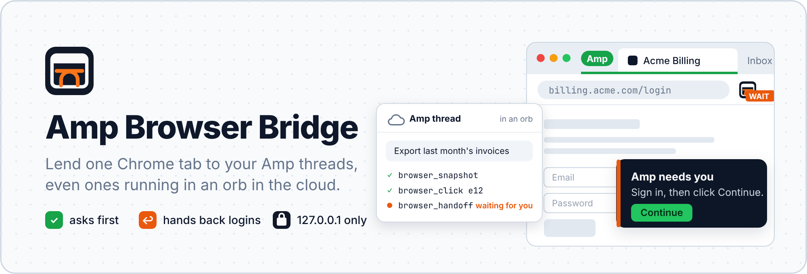

<p>
  <picture>
    <source media="(prefers-color-scheme: dark)" srcset="docs/banner-dark.png">
    
  </picture>
</p>

Works with [Amp](https://ampcode.com) threads on your Mac and in orbs, using your existing browser logins.

Amp asks before clicking or typing, and hands the tab back to you for logins, 2FA, and payments.

Heavily inspired by [OpenCode Browse](https://opencode.ai/product/browse).

## Why it's safe

- Amp can only see the tab you lend (or background tabs it opens, if you turn that on). It can't read your other tabs, cookies, or history.
- Lent tabs start read-only and locked to their current site until you allow actions or other sites in the popup.
- During a handoff, Amp can't see or touch the tab until you click **Continue**.
- The bridge only listens on `127.0.0.1`. Orbs connect through an Amp portal behind your Amp login, using signed requests.
- Click **Stop lending** or close the tab at any time to disconnect it.

Approval prompts happen in the plugin, so code running in an orb can bypass them and call the bridge directly. See [Security](#security) for details.

## Set up

You'll need the [Amp macOS app](https://ampcode.com/docs/apps/mac) with **Run threads on this Mac** and **Allow Portals** enabled (`App Settings → Runner`), plus Chrome 116+.

1. **Install the plugin.** In any Amp thread, ask:

   ```prompt
   Install the plugin/ directory from https://github.com/lox/amp-browser-bridge into my personal plugins as browser-bridge, then push it.
   ```

   New threads on your Mac and in orbs pick it up from your personal plugins repo.

2. **Load the extension.** Chrome Web Store review is still pending, so load it unpacked for now. Download and unzip `amp-browser-bridge-<version>.zip` from the [latest release](https://github.com/lox/amp-browser-bridge/releases/latest). Open `chrome://extensions`, turn on **Developer mode**, click **Load unpacked**, select the unzipped folder, and pin the extension to Chrome's toolbar.

   Installing opens the setup checklist (or click **Setup and status** in the popup).

3. **Pair.** In an Amp thread on your Mac, ask *"pair the browser extension"*. Amp opens the setup page with a one-time code and pairs automatically.

4. **Publish to orbs** *(optional if you only run local Mac threads)*. In an Amp thread on your Mac, ask *"publish the browser bridge"* and confirm. Your runner must serve your home directory, or `~/.amp-browser-bridge` itself (`amp runner dirs add ~/.amp-browser-bridge`); publishing warns if it doesn't. Keep that thread unarchived: Amp refuses orbs' sign-in to an archived thread's portal.

<p align="center"></p>

## Usage

Open a page, click the extension icon, and click **Lend this tab**. The tab joins a green **Amp** tab group and starts read-only on that site.

Popup controls:

- **Allow clicks, typing and navigation** - lets Amp click, type, and navigate. Amp asks before each action, with an option to allow that site for the thread.
- **Allow other sites** - lets Amp navigate to other sites. If this is off and you navigate away yourself, Amp is blocked until you go back.
- **Release to other threads** - frees the tab from the current thread (one thread holds it at a time, with a 10-minute idle timeout) without ending the lend. **Stop lending** disconnects the tab.

If a modal or banner covers the element Amp tries to use, the action fails instead of clicking whatever is on top.

### Background tabs

Turn on **Let Amp open its own tabs** in the popup to let threads open background tabs without you lending one. Amp asks before opening a site, then puts the tab in a collapsed **Amp** group; the popup lists open tabs with **Show** and **Close**.

- Only the thread that opened a tab can use it. Actions work on any site (still with approval prompts), and idle tabs close after 10 minutes.
- Chrome freezes hidden background tabs, so each command wakes the tab first so the page still reacts.
- Dragging a tab out of the group, lending it, editing the group, or cancelling Chrome's debugger bar turns it into a normal tab.

**Known issue:** Chrome silently drops clicks and `submit` Enter keys on background tabs that have never been visible, even though the tool reports success. Click the tab (or **Show** in the popup) once to work around it.

### Bot checks

When navigating or taking a snapshot, the extension checks for bot challenges (Cloudflare, CAPTCHAs, PerimeterX, DataDome) and block pages. On navigation it waits up to 12 seconds for automatic checks to clear. If a challenge needs a human, it tells Amp to hand the tab over instead of trying to solve it; on a block page, it tells Amp to stop. Detection is adapted from [anomalyco/browse](https://github.com/anomalyco/browse).

## Troubleshooting

Check **Setup and status** in the popup first. Each failing check explains how to fix it.

- **Setup page blocked during pairing:** reload the tab. If it stays blocked, open **Setup and status** from the popup once so the bridge learns your unpacked extension ID, then pair again (or paste the code from `~/.amp-browser-bridge/pairing-code`; codes expire after 10 minutes).
- **Orbs can't reach a published bridge:** the portal answers 503 when the runner doesn't serve `~/.amp-browser-bridge` (add it with `amp runner dirs add ~/.amp-browser-bridge`), and for up to 15 minutes after the runner restarts, until the bridge republishes. To fix it straight away, run *"publish the browser bridge"* again from a Mac thread. Orbs that were already running need `amp orb restart-processes` to pick up updated secrets.
- **Asked to pair again:** the bridge stores one browser key at a time, so pairing another Chrome profile or browser replaces the previous one. Browsers paired before `v0.2.0` also need an updated Mac plugin and a fresh pair.

## Tools

| Tool | Description |
| --- | --- |
| `browser_status` | Connection status, lent tab, active thread, background tabs, and handoff state |
| `browser_open_tab`, `browser_close_tab` | Open or close a background tab for the current thread |
| `browser_snapshot` | Accessibility tree with element refs (`e12`) |
| `browser_screenshot` | Viewport screenshot (JPEG) |
| `browser_wait_for` | Wait up to 20s for text, a URL, or an element by role and name |
| `browser_scroll` | Scroll the page |
| `browser_click`, `browser_type`, `browser_navigate` | Click, type, or navigate (URLs that trigger a download return `download`) |
| `browser_fill` | Fill a field, hiding password and one-time-code values in prompts and results |
| `browser_press` | Press a key (`Enter`, `Escape`, `Tab`, etc.) on an element or the focused target |
| `browser_select` | Select a `<select>` option by value or label |
| `browser_handoff` | Hand the tab back to you and wait up to 30m for **Continue** (re-attaches if an earlier call disconnected) |
| `browser_bridge_pair` | Mac only: open the setup page with a new pairing code |
| `browser_bridge_publish` | Mac only: publish the bridge through an Amp portal (republishes on startup) |

Page tools take an optional `tab` ID from `browser_open_tab`, defaulting to the lent tab. Tools that change the page ask for approval first.

`browser_status` is in every thread's tool list from the start, so telling a thread "I lent you a tab" or "use my browser" is enough; the other tools load through Amp's tool search when needed.

Chrome blocks extensions on Chrome Web Store pages, so tools refuse them and navigating a lent tab there ends the lend.

`main` can be ahead of the latest release. To try unreleased changes, load `extension/` from a checkout of `main`.

## Security

Treat page content as untrusted: because Amp reads pages in your signed-in browser, prompt injection in a page or email can try to steer the agent.

- Requests and responses are HMAC-signed with `BROWSER_BRIDGE_TOKEN` (`~/.amp-browser-bridge/token`, `0600`) using a 5-minute window and single-use nonces; the token itself is never sent. Cross-origin browser requests are rejected, and orbs connect through an Amp portal behind your Amp login.
- Pairing negotiates a browser key over ECDH + PBKDF2 (single-use 10-minute code, 5-attempt lockout), and every WebSocket connection runs a mutual HMAC check before sharing state. The WebSocket only accepts loopback connections from this extension's ID, blocking web pages, other extensions, and DNS rebinding.
- The extension enforces tab scope, read-only mode, single-site lock, and handoffs. Approval prompts live in the plugin, so orb processes with `BROWSER_BRIDGE_TOKEN` can bypass them: keep lent tabs read-only unless you trust the orb, and leave **Let Amp open its own tabs** off unless you want orbs able to open and drive any site. Thread leases only stop threads from stepping on each other.
- Same-user processes on your Mac can read `~/.amp-browser-bridge` and your Chrome profile directly. A local process without that file access that grabs port `19989` while the bridge is stopped can see incoming tool calls (and replay one within 5 minutes) or force a re-pair, without being able to forge requests or signed responses.
- Snapshots omit form values, screenshots capture visible pixels, and `browser_fill` hides password/OTP values in prompts and output (though the agent chose the value). Element refs (`e12`) reset on navigation and check role and name; if focus moves while typing or a connection drops mid-action, the tool returns `unknown` without retrying. Pages can't click **Continue** on their own handoff card, though they can cover it (use **Continue** in the popup instead). Single-site lock only restricts navigation, not requests made by the page itself.

## How it works

<p>
  <picture>
    <source media="(prefers-color-scheme: dark)" srcset="docs/how-dark.png">
    
  </picture>
</p>

On macOS, `plugin/index.ts` runs the local bridge (`plugin/host.ts`) on `127.0.0.1:19989`; whichever Amp process binds the port first hosts it, and another takes over if it exits. Elsewhere, the plugin runs as a client, reading `BROWSER_BRIDGE_URL` and `BROWSER_BRIDGE_TOKEN`, signing in with `amp portal login-url`, and forwarding tool calls. Override the role with `AMP_BROWSER_BRIDGE_ROLE` (`host`, `client`, or `off`), change the port with `BROWSER_BRIDGE_PORT`, or run the bridge standalone with `bun plugin/host.ts`.

Publishing opens a [runner portal](https://ampcode.com/docs/cli/runners) from `~/.amp-browser-bridge` (keeping the portal URL stable across restarts), stores `BROWSER_BRIDGE_TOKEN` as a personal secret and `BROWSER_BRIDGE_URL` as a personal environment variable for new orbs, and republishes through that thread on startup and every 15 minutes. The portal belongs to that thread: while the thread is archived, Amp refuses orbs' sign-in to it (`amp portal login-url` says the account is not authorized), and the bridge won't republish through it. After a runner restart it answers 503 until republished.

The extension (`extension/`) attaches `chrome.debugger` only to the lent tab and background tabs Amp opened. Active lend state, snapshot refs, and pending handoffs live in `chrome.storage.session` across service worker restarts; the pairing key (`extension/pairing.js`) and agent tab list live in `chrome.storage.local`. The bridge records the last extension ID seen on `/status` in `~/.amp-browser-bridge/extension-id` so pairing opens `setup.html#code=<code>` in whichever build (unpacked or Web Store) you have installed.

## Develop

```sh
bun install
bun run check   # typecheck, extension syntax check, unit tests
bun run e2e     # e2e suite in headed Chrome against a local bridge
```

`bun run e2e` runs `test/e2e/*.e2e.ts` against a fresh bridge and headed Chrome for Testing (via Xvfb on headless Linux) using ports `8765`, `9333`, and `19989`, so quit any running bridge first. Branded Chrome ignores `--load-extension`; set `CHROME_BIN` to override agent-browser's Chrome for Testing binary. Pass a script name to run one test (e.g. `bun run e2e popup`), or set `E2E_SHOTS=<dir>` to save screenshots.

Inside an Amp orb, `portal.e2e.ts` also tests the client plugin end to end through the thread's portal using a mount namespace and passwordless `sudo`, without touching your `BROWSER_BRIDGE_*` secrets. Checks marked `KNOWN` track known bugs without failing the run. Buildkite runs both suites via [`.buildkite/pipeline.yml`](.buildkite/pipeline.yml).

`test/fixtures/challenges/` stores scrubbed probes from real bot challenges, block pages, and normal pages for `test/challenge.test.ts`. After editing `extension/`, click **Reload** in `chrome://extensions`. `docs/art/art.ts` generates the README diagrams and `docs/tweet-card.png`.

## Release

```sh
bun run release            # dist/amp-browser-bridge-<version>.zip (with manifest key)
bun run release --no-key   # without manifest key, for Chrome Web Store uploads
```

Bump the version in `extension/manifest.json` before releasing. `bun run release` builds a reproducible zip of `extension/`.

Unpacked builds keep a fixed extension ID (`goknnphohomgekkahpdiphdfladfnmoc`, `UNPACKED_ID` in `plugin/extension-id.ts`) via the `key` in `extension/manifest.json`. Chrome Web Store uploads strip that key with `--no-key` and use `STORE_ID`; the bridge accepts both.

See [`docs/chrome-web-store.md`](docs/chrome-web-store.md) for the Web Store listing and upload checklist, [`docs/privacy.md`](docs/privacy.md) for the privacy policy, and `scripts/store-images.ts` to render `docs/store/` assets.

## License

[MIT](LICENSE)
